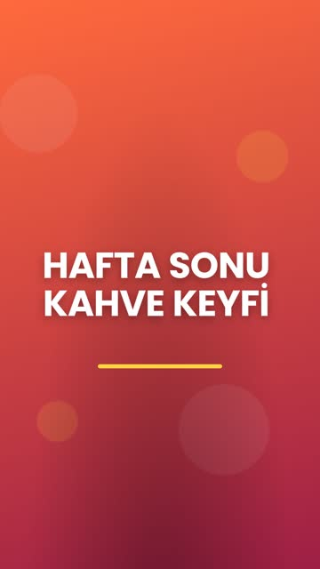

<div align="center">

# 🎬 Motion Plus

**Write a brief. Get a video.**

A set of Claude skills plus a Remotion template that turns a JSON brief and a brand preset into a branded vertical video (1080×1920, 30 fps), with captions, motion design and a built-in quality check.


&nbsp;&nbsp;


</div>

---

## What's inside

| | |
|---|---|
| 🧾 **Promo Reel** | `brief.json` + brand preset → 15 / 30 sec vertical promo (hook → offer → points → CTA) |
| 🎙️ **Talking-Head Edit** | Raw selfie clip → silence cuts, punch-in zooms, word-by-word captions, -14 LUFS audio |
| 💬 **Word Captions** | TikTok-style captions that highlight the spoken word, locale-aware (works great in Turkish) |
| 🧠 **Motion Design** | Timing, easing and choreography rules so nothing moves like a PowerPoint |
| 🎨 **Brand Presets** | Colors, CTA, banned phrases and house rules per client, enforced in every video |
| 🔍 **Review Loop** | Contact sheets, phone-size test, first-frame and loudness checks before anyone sees it |
| 🧸 **Cartoon Studio** | Pipeline for 2.5D animated shorts (flat 2D characters in lit 3D Blender sets) |

## Quick start

Requirements: Node 18+, ffmpeg, Python 3.10+ (only for the talking-head edit).

```bash
git clone https://github.com/Mmbugraaslan/motion-plus.git
cd motion-plus/studio
npm install
bash ../scripts/render.sh briefs/demo-15.json
# → studio/out/demo-15.mp4 + review sheets in studio/out/review/
```

Preview and tweak live in Remotion Studio:

```bash
npm run studio
```

## Use it with Claude

**Claude Code (plugin):**
```
/plugin marketplace add Mmbugraaslan/motion-plus
/plugin install motion-plus@motion-plus
```

**Any Claude client with skills:** copy the skills into your skills folder:
```bash
bash scripts/install-skills.sh
```

Then just ask:
> "Make a 15 and 30 sec promo for the demo brand: 30% off all cold drinks this weekend."
> "Here's my selfie clip, edit it for Instagram with captions."

`CLAUDE.md` holds the house rules Claude follows in this repo.

## Promo reel from a brief

```json
{
  "brand": "demo",
  "duration": 15,
  "hook": "Write a brief get a video",
  "offer": { "label": "Render time", "value": 15, "suffix": " sec" },
  "points": ["Brand presets", "Word-timed captions", "Built-in quality check"],
  "terms": "Made with Claude skills + Remotion."
}
```

```bash
bash scripts/render.sh briefs/my-promo.json
```

Optional fields: `cta`, `ctaLead`, `voice`, `music`, `musicVolume`, `captions`, `emphasize`, `useMascot`.
Every scene scales to `duration`, so one brief gives you both a 15 and a 30 sec cut.

## Brand presets

```json
{
  "id": "sunset",
  "name": "Sunset Coffee",
  "locale": "tr",
  "colors": { "bg": "#FF6A3D", "bgDeep": "#9E1F45", "ink": "#FFFFFF", "accent": "#FFD23F", "dark": "#2A0A1A" },
  "cta": "sunsetcoffee.com",
  "ctaLead": "Hemen sipariş ver",
  "mascot": null,
  "bannedPhrases": ["en ucuz", "bedava"],
  "rules": ["Campaign terms are quoted exactly as written by the client."]
}
```

Add `studio/brands/<id>.json` and register it in `studio/brands/index.ts`. Put a mascot PNG under `studio/public/` and point `mascot` at it.

## Talking-head auto-edit

```bash
pip install faster-whisper
python3 scripts/talking_head.py my-clip.mp4 --name my-reel --lang en \
  --fix "cloud=Claude" --emphasize free today
bash scripts/render.sh edits/my-reel.json --comp TalkingReel
```

What it does:
1. Normalizes to 1080×1920, 30 fps, -14 LUFS
2. Finds speech vs. silence and cuts the gaps (with breathing room)
3. Transcribes with word timestamps (any Whisper language)
4. Builds one caption track per sentence and alternates punch-in zooms on every cut

## Project layout

```
skills/            Claude skills (promo-reel, talking-head-edit, word-captions,
                   motion-design, review-loop, cartoon-studio)
studio/            Remotion project
  brands/          brand presets
  briefs/          promo briefs
  edits/           generated talking-head edits
  src/             compositions: PromoReel, TalkingReel, WordCaptions, scenes
scripts/           render.sh, check_export.sh, talking_head.py, install-skills.sh
CLAUDE.md          house rules
```

## Quality check

Every render runs `scripts/check_export.sh`:
- prints resolution, fps and duration
- writes a 1-fps contact sheet, a 360 px phone-size sheet and the first frame

The `review-loop` skill has Claude review those like a strict director and fix the worst 3 issues per pass.

## License

MIT, see [LICENSE](LICENSE). Third-party notices (Remotion, LottieFiles motion-design skill, Poppins) are in [NOTICE.md](NOTICE.md).
Remotion is free for individuals and small teams. Companies above that size need a [Remotion company license](https://www.remotion.dev/license).
